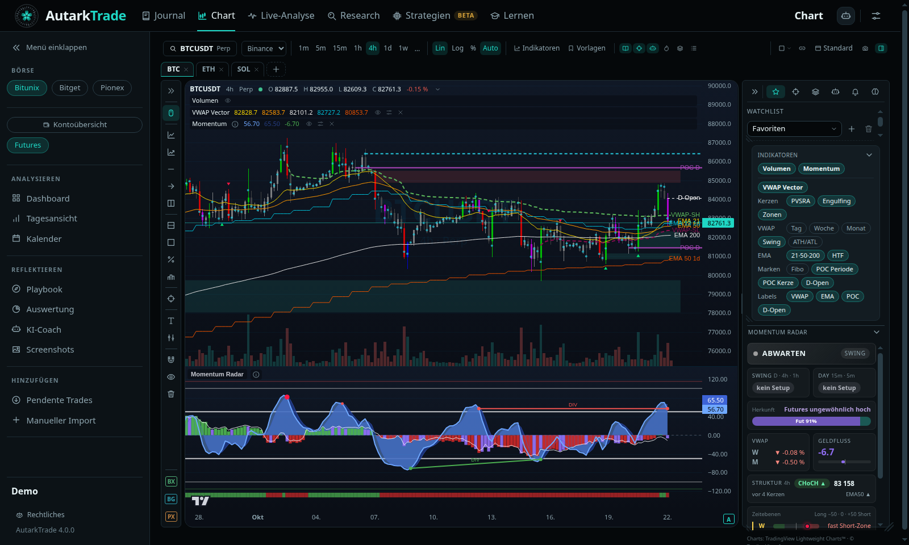
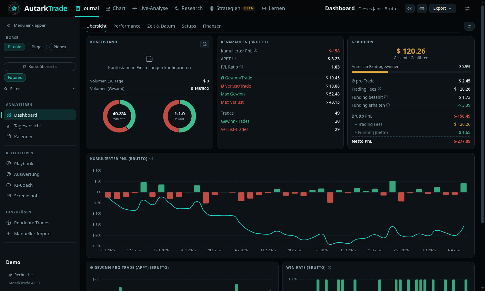

# AutarkTrade

A self-hosted trading journal and analysis workstation for **crypto futures** on **Bitunix**, **Bitget** and **Pionex**.
It runs on your own machine or NAS: no cloud, no account, no subscription.

> **Status:** 4.4.4 (beta) · interface in **German** (default) and **English** · free software under AGPL-3.0





## What it does

- **Journal** — imports your trades through the exchange APIs (read only) and shows P&L, win rate, fees,
  calendar, playbook, tags and screenshots.
- **Chart workspace** — multi-panel charts with drawings, indicators, alerts and an AI analysis that only
  picks from levels the code has measured.
- **Market view** — Marktradar (fear & greed, funding, open interest, liquidations), news briefing,
  Hype-Radar and Coin-Radar for finding tradable coins.
- **Pionex bots** — every running and finished grid bot with real profit after fees, a planner for new
  bots, a what-if simulation, and an optional bot control.
- **Strategies** — backtests and paper trading as a simulation.
- **Portfolio** — spot holdings, DCA, staking and a tax overview (beta).
- **Stocks** — tokenised stocks and stock futures on the connected exchanges (beta, off by default).
- **AI coach** — a side panel that answers questions about the page you are on, with your own API key
  (Anthropic, OpenAI, Gemini, Ollama and others).
- **Companions** — Android widget, Linux desklet and ESP32 displays for your open positions.

Everything in detail: [FEATURES.md](FEATURES.md).

## What it does not do

AutarkTrade **places no orders by itself**. Strategies are simulation only. The one exception is the
Pionex bot control: it is off by default, needs a separate key without withdrawal rights and your consent,
checks every change with Pionex first and sends only what you confirm.

Nothing in the app is investment advice. AI output can be wrong.

## Install

**Docker** (recommended for a NAS):

```bash
git clone --depth 1 https://github.com/Mouses007/AutarkTrade.git
cd AutarkTrade
cp .env.example .env    # set the database and AT_SECRET
docker compose up -d
```

**Local** (Linux, macOS, Windows — needs Node.js 22 and Git):

```bash
git clone --depth 1 https://github.com/Mouses007/AutarkTrade.git
cd AutarkTrade
./install.sh            # Windows: install.bat · macOS: install-mac.command
npm start
```

Then open `http://localhost:8080`, set a password and enter your exchange API key under
**Einstellungen › Börsen**. SQLite works out of the box; PostgreSQL is optional.

Updates come through the update button in the side menu or with `docker compose pull && docker compose up -d`.
Your database is kept. HTTPS for the LAN, configuration and all install variants:
[FEATURES.md](FEATURES.md#installation) and [DOCKER.md](DOCKER.md).

## Built with

Vue 3, Express, Knex (SQLite or PostgreSQL), Apache ECharts and
[Lightweight Charts](https://github.com/tradingview/lightweight-charts) by TradingView (Apache-2.0).
All third-party licences: [THIRD-PARTY-NOTICES](THIRD-PARTY-NOTICES), [NOTICE.md](NOTICE.md).
Origin of the code base: [HERKUNFT.md](HERKUNFT.md).

## Licence

**GNU Affero General Public License v3.0 or later** — [LICENSE](LICENSE). Copyright (C) 2026 Mouses007.
Provided without any warranty; on first start the app asks you to accept the disclaimer
([HAFTUNGSAUSSCHLUSS.md](HAFTUNGSAUSSCHLUSS.md)).

If AutarkTrade is useful to you: side menu › **Buy me a coffee**.
